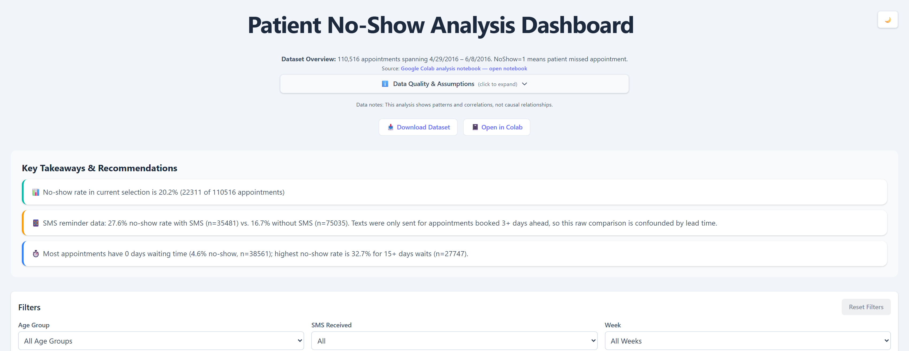
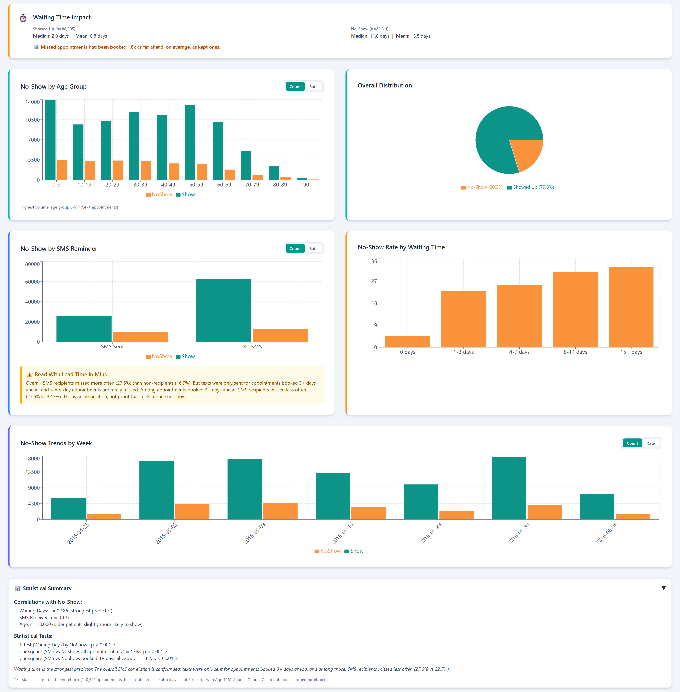
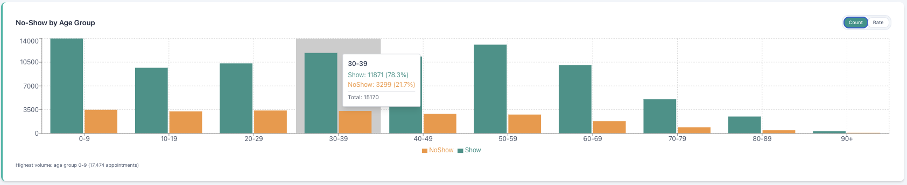
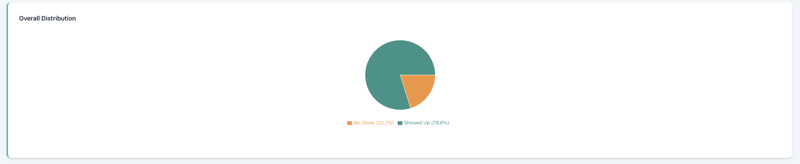
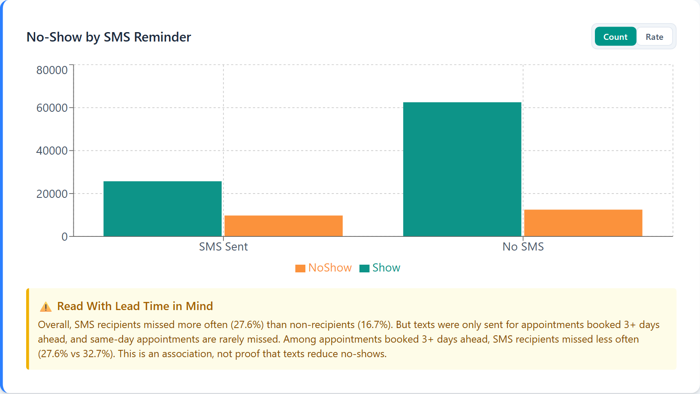
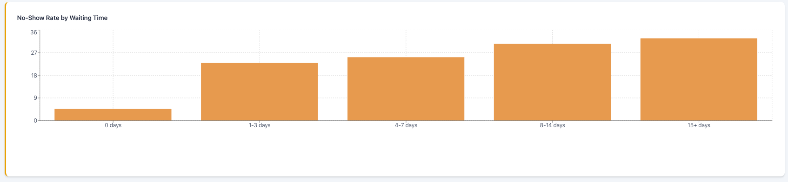
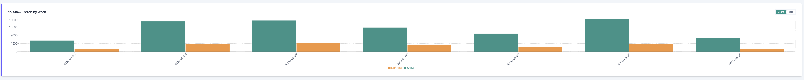
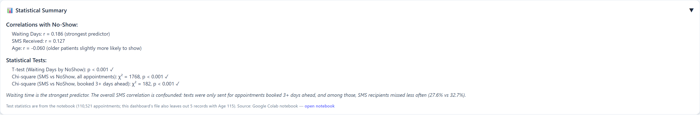

# TruBridge Patient No-Show Analysis (EDA + dashboard)

**Live dashboard:** https://patient-noshow-dashboard.vercel.app/  
**Notebook:** [docs/notebook/TruBridge_NoShow_Analysis_FINAL.ipynb](docs/notebook/TruBridge_NoShow_Analysis_FINAL.ipynb) ([open in Colab](https://colab.research.google.com/github/ivan-711/Externship-TruBridge/blob/main/docs/notebook/TruBridge_NoShow_Analysis_FINAL.ipynb))  
**Repo:** https://github.com/ivan-711/Externship-TruBridge  
**One-pager (PDF, Jan 2026, written before the correction below):** [one-pager-trubridge-noshow.pdf](docs/one-pager/one-pager-trubridge-noshow.pdf)

Built during the Extern.com **TruBridge Healthcare Data Analytics Externship** (Nov 2025 – Jan 2026, remote).

I analyzed 110,527 public medical appointment records in Python (pandas): cleaned the raw data, engineered `WaitingDays` (lead time from booking to appointment), ran statistical tests, trained a baseline logistic regression model, and published the findings in a React dashboard.

---

## Correction (Oct 2026)

The first published version of the notebook computed lead time by subtracting raw timestamps. `ScheduledDay` includes the time of booking while `AppointmentDay` is always midnight, so every same-day appointment came out as -1 day and the "drop negative waits" filter removed **38,568 rows** (38,563 same-day appointments plus 5 real errors), leaving 71,959. The notebook's outputs therefore described a different subset from the numbers reported here and on the dashboard, which had been computed in the original Step 2 EDA notebook on the full data with calendar-day waits.

The notebook now compares calendar dates (same-day = 0), drops only the 6 true error rows, and has been re-executed top to bottom on the resulting **110,521 rows**. Every number below comes from those saved outputs. The SMS conclusion was withdrawn (see Results). The original notebook is kept unchanged at [docs/notebook/legacy/TruBridge_NoShow_Analysis_FINAL_original.ipynb](docs/notebook/legacy/TruBridge_NoShow_Analysis_FINAL_original.ipynb), and the first cell of the corrected notebook explains the change in detail.

---

## Data

- **Source:** Kaggle, [“Medical Appointment No Shows”](https://www.kaggle.com/datasets/joniarroba/noshowappointments) (medical appointments in Brazil; file `KaggleV2-May-2016.csv`, **110,527 rows × 14 columns**; appointments from Apr 29 to Jun 8, 2016). Dataset by Joni Hoppen / Aquarela Analytics, licensed CC BY-NC-SA 4.0.
- **Target:** `NoShow` (0 = showed up, 1 = missed the appointment)
- **Key fields used:** `Age`, `SMS_received`, `ScheduledDay`, `AppointmentDay`
- **Feature engineered:** `WaitingDays` = calendar days from the booking date to the appointment date (same-day = 0)
- **Cleaning:** removed 6 invalid rows: 5 appointments dated before they were booked and 1 with Age = -1. **110,521 rows analyzed.** No missing values or duplicate rows were found.

### Published dataset

`docs/datasets/publicsafefinalnoshowdataset.csv` (the same file the dashboard loads) has **110,516 rows**:

- The `PatientId` and `AppointmentID` columns were removed before export.
- That is the only de-identification step. The file still has booking timestamps, appointment dates, neighborhood, age and gender, so it is not de-identified in the HIPAA Safe Harbor sense. The source data is already public on Kaggle.
- Compared with the 110,521-row analysis set, it also leaves out 5 records with Age 115, rounds the two normalized columns, and adds four label columns for the charts (`NoShowLabel`, `SMSLabel`, `AppointmentDate`, `AgeGroup`). The wait-time means are the same (8.75 vs 15.84 days).
- `AgeGroup` shows `19-Oct` on some rows. That is an Excel date-conversion artifact for `10-19`; the dashboard maps it back.

---

## Key questions

- How does **lead time** (days from booking to appointment) relate to no-shows?
- How do **SMS reminders** relate to no-shows once lead time is taken into account?
- Which **age groups** have higher no-show rates?
- Do no-shows shift **week to week**?

---

## Results (110,521 appointments)

- **No-show rate: 20.19%** (22,314 missed). Same-day appointments: 4.65% missed; appointments booked at least a day ahead: 28.52%.
- **Lead time:** missed appointments had been booked **1.8x as far ahead** as kept ones, on average: **15.84 vs 8.75 days** (medians 11 vs 2; Welch t-test p < 0.001). Much of this gap comes from same-day visits, which are rarely missed. Among appointments booked at least a day ahead, the means are 17.22 vs 15.01 days.
- **SMS reminders: no reminder effect is claimed.** Across all appointments, SMS recipients missed more often (27.6% vs 16.7%; chi-square 1767.98, p < 0.001). But no texts were sent for appointments booked 0–2 days ahead, so that comparison is confounded by lead time. Among appointments booked 3+ days ahead, SMS recipients missed less often (27.6% vs 32.7%; chi-square 182.03, p < 0.001). This is observational data, so neither comparison shows that texts cause or prevent no-shows.

*Association only. This analysis does not establish causes.*

---

## Baseline model (logistic regression)

- Features: `Age_normalized`, `WaitingDays_normalized`, `SMS_received`; 80/20 stratified split (`random_state=42`), 22,105 test appointments
- Majority-class baseline (predict every appointment as “show”): **79.81%** accuracy
- Model accuracy: **79.60%**, so the model **did not beat the majority-class baseline**
- It flagged only 180 test appointments as likely no-shows and caught 67 of the 4,463 actual no-shows. These three features and the class imbalance don't give enough signal for useful prediction.

---

## Dashboard screenshots

**Overview**  
  


**Charts**  
  
  
  
  


**Summary**  


---

## Repo structure

- `docs/notebook/` → the analysis notebook (cleaning, EDA, tests, model) with saved outputs, plus `requirements.txt`
- `docs/notebook/legacy/` → the original notebook from before the Oct 2026 correction, unchanged
- `docs/datasets/` → the published, ID-free dataset used by the dashboard
- `docs/one-pager/` → one-page summary (Jan 2026)
- `docs/screenshots/` → dashboard screenshots
- `patient-dashboard/` → React + Vite dashboard app (deployed on Vercel)

---

## Re-run the notebook

Download `KaggleV2-May-2016.csv` from Kaggle and put it next to the notebook (in Colab, upload it to the Files sidebar instead). Then:

```bash
python -m venv .venv
source .venv/bin/activate        # Windows: .venv\Scripts\activate
pip install -r docs/notebook/requirements.txt
cd docs/notebook
jupyter nbconvert --to notebook --execute --inplace TruBridge_NoShow_Analysis_FINAL.ipynb
```

## Run the dashboard locally

```bash
cd patient-dashboard
npm install
npm run dev
```
